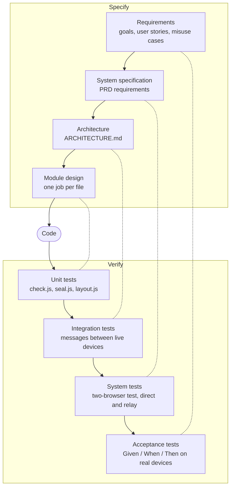

# Testing: universal sharing

How the product is tested. Requirement IDs are in the [PRD](PRD.md). Misuse cases are in the [threat model](THREAT-MODEL.md#misuse-cases). The design being tested is in [ARCHITECTURE.md](ARCHITECTURE.md).

## 1. Approach (V-model)
Each level of specification is paired with the level of testing that proves it. Development itself is iterative and tracked on the project board. The V-model is used to plan the tests.



## 2. Test plan
Which level of test proves each requirement. Results are recorded on each requirement's issue.

| Requirements | Level | Test |
|---|---|---|
| G1, N1 | Acceptance | A first-time user shares one photo from an iPhone to a laptop, timed from opening the link to "Tap to save" |
| G1, N1 | System | The two-browser test records time to ready and transfer time, direct and relay. The measured relay speed is written into the test output so the 15 s target can be checked against real numbers |
| N4 | Acceptance | Share a file using only the keyboard, then with VoiceOver |
| US1–US17 | Acceptance | Each Given / When / Then on real devices |
| Misuse cases | Acceptance, Integration | Each attack must fail. The threat model says which run automatically |
| C2–C9, C13 | System | Two-browser test, direct and relay (exists) |
| C6 | System | The two-browser test puts a print on B's screen with a plain move. B taps it: it says "Receiving…", asks once even when tapped again while the photo is arriving, and the file arrives byte-identical. A print whose middle is on another screen still says "Drag it onto your screen first" and fetches nothing. With every incoming slot taken, a tap says "Too many photos arriving. Try again in a moment" and asks for nothing. Your own print says "Already yours" (exists) |
| C5 (time keeper hand-over, #61) | Unit, System | `tests/net.test.mjs`: when the time keeper leaves, devices that hear it late, in either order, still end up with the new time keeper's layout, and use a kept layout that still holds at once. A layout from a device that isn't the time keeper is still not used, nor one it sent before the time keeper's own, nor one naming a device that has since left, nor one from a device that wasn't in the room when it sent it. They also show the new time keeper's join results (Joined, Try again, No match) instead of their own timeout, in either order (#96). Results from a device that never becomes the time keeper, from a device not in the room, or naming a device that has since left are not used, and at most `EARLY_RESULTS` are kept per device. When the new time keeper leaves straight away, the next one takes over and the rest agree on its layout, in either order. When nothing usable was kept, the device asks the new time keeper for its layout. When a late layout from the old time keeper arrives after the new one's, the device asks the new time keeper for its layout and ends up with it. A lost ask or a lost answer is asked for again, asking stops once the layout arrives, and a device that never gets an answer gives up after `ASK_TRIES` asks at least `LAYOUT_GAP` apart. Only the time keeper answers a layout ask, a malformed one is dropped, and a flood of asks gets at most one answer per `LAYOUT_GAP`. The two-browser test holds back B's and C's presence updates in a four-device room so C hears A leave after B has sent a new layout and joined C, checks C shows "Joined with" B and not its own "No match" (#96), then has B leave straight away (exists) |
| C14, F1, F5, F7–F10 | System | New two-browser cases (to write) |
| N2, Q2 | System | Two-browser test in Chromium and WebKit |
| Q1 | System | Two-browser test as a required GitHub check |
| C10, N3, S1.1, S1.2, S1.4, S1.6, S2, S7, S10 | Integration | The attack or malformed message is sent between live devices and must change nothing |
| S1.3 | Unit, System | `tests/peers.test.mjs`: a device that never sends its key or never drains its buffer is given up on after 10 s, a draining or throttled link finishes, a dropped message is reported so a print can be announced again when a late key arrives, and one relay frame that fails to send doesn't block later frames. The two-browser test asks for a photo from a silent device while two others keep transferring, checks a read error isn't blamed on the other device and holds back a device's key for 11 s so a print to it is dropped, then checks the print is announced again once the key comes (exists) |
| S1.5 | Unit, Integration | `tests/asks.test.mjs`: 3 whole sends per device per file in any 60 s, again after 60 s, dropped asks not counted, per device and per file, piece asks once a second with retries 1.5 s apart never dropped, counters forgotten when a device leaves and capped with stale ones going first, and which needs count as whole. The two-browser test has B send A 20 wants for one photo, then 20 needs listing every piece of another file: A sends each at most 3 times, and a third device that asks once still gets the photo (exists) |
| S3 | Integration | Matching words. A swapped key makes them differ |
| C1, C11 | Unit | `tests/check.test.mjs` (exists) |
| S6 | Unit, System | `tests/strip.test.mjs`: iPhone- and Android-style JPEG fixtures lose GPS and camera details, stay upright and a JPEG without metadata is unchanged. The two-browser test sends one with and one without "Keep details" (exists) |
| S5, S12 | Unit | New fixtures for file types and links (to write) |
| `seal.js`, `layout.js` | Unit | Key derivation, sealing and layout solving (to write) |
| F2 | System | Progress and error messages appear during a transfer and a failed fingerprint check (to write) |
| F3 | Acceptance | Save a received photo to the camera roll on an iPhone and an Android phone (manual) |
| F4 | System | A file already held is marked and not requested again (to write) |
| F6 | System | 50 prints added at once never fully cover each other (to write) |
| S4 | Integration | A device the host hasn't accepted receives nothing (to write) |
| S9 | Integration, Acceptance | A blocked device's prints disappear. A stranger's thumbnail is blurred (to write) |
| S11 | Integration | A room's code stops working 30 minutes after the last device leaves (to write) |
| S13 | System | After Leave, no received file or thumbnail is left in memory and the tab's keys are gone from IndexedDB (to write) |
| S14 | Unit, System | `tests/thumb.test.mjs`: a thumbnail over 400 × 400 pixels, whose size can't be read or with bytes after its end marker is not decoded. The two-browser test sends 400 × 400, 401 × 400, a 30000 × 30000 image bomb and a 400 × 400 with 30000 bytes after its end: only the first is decoded, the others show a plain card (exists) |
| S15 | Acceptance | The site loaded inside another site's frame refuses to run (manual) |
| S16 | System | The room code is gone from the address bar after joining (to write) |
| S8 | Integration | A client without a token from the site cannot join a room's channel (to write) |
| Q3 | Acceptance | The Qodo review standards list shows one fingerprint standard (manual) |
| S17 | Unit | HEIC, PNG, WebP and video fixtures with GPS arrive without it (to write) |
| L2 | Acceptance | A first-time user joins screens with only the on-screen guide (manual) |
| C15 | System | Two browsers click facing join strips within 2 s and join where they clicked. Non-facing strips don't join and nor do taps 3 s apart. Two phones stack on one laptop edge with one laptop tap each. A lone tap shows no match (to write). Undo is tested with #85 |
| C16 | Integration | A mini-map request joins nothing until the other device accepts. "No" leaves both screens as they were (to write) |
| F11, F12 | System | Three devices: a print dropped into a joined space is fetched by both others with no drag. A print shared with everyone reaches a device that isn't joined. A 30 MB file waits for a tap. Nothing is fetched by itself during a join's 10-second Undo window, nor prints from before the join (to write) |
| F13 | Acceptance | "Save all" opens the share sheet once with every received photo on an iPhone and an Android phone (manual) |
| F16 | System | A drag ended by `pointercancel` puts the print back. A print pushed past the screen edge keeps 40 px on screen. A print dropped across a shared edge ends fully on one screen (to write) |
| F17 | System | Click, move, click moves a print with no button held. Esc puts it back (to write) |
| F18 | Acceptance | On a real iPhone and Android phone, using the site never triggers a back swipe, a pull-down panel or the home bar (manual) |
| S18 | System | Reloading a joined device mid-transfer keeps its id, name and join. The transfer restarts and finishes. No received bytes are in IndexedDB. A duplicated tab gets a new id. After a tab closes, the next start-up deletes its stored keys (to write) |
| S19 | Unit | A table of names: "Sam" clashes with "sam", "SAM", "Ｓａｍ" and " Sam "; "José" clashes with "Jose"; "Sam M" doesn't clash with "Sam"; names with a zero-width space, a text-direction override, Latin mixed with Cyrillic ("Ѕam") or 25 characters are refused; "山田さくら" (Han with Hiragana) is allowed; two different Devanagari names that differ only in a vowel sign don't clash; "👩‍👩‍👧" is allowed and counts as one character (to write) |
| S20 | System | With "Remember this device" on, a reload in a new tab shows "seen before" to the other device. A different device using the same name shows "new device". Forget clears both. A device that never turned it on isn't stored by anyone (to write) |
| R1–R4 | System | Chaos runs of the browser test: a share of relay frames dropped, a holder stopped halfway, a device delayed, a piece corrupted. Each must still end with the right SHA-256. Results go to the R4 dashboard (later) |

## 3. Running the tests
```sh
npm run test:unit       # unit tests
npm run test:browsers   # two-browser test, direct then relay (needs internet)
npm test                # both
```

On every PR into main, GitHub Actions runs `npm test` in the same Playwright image the factory uses (`.github/workflows/tests.yml`). The `protect main` ruleset makes that `npm test` job a required check, so a red PR can't merge (Q1, #34).
