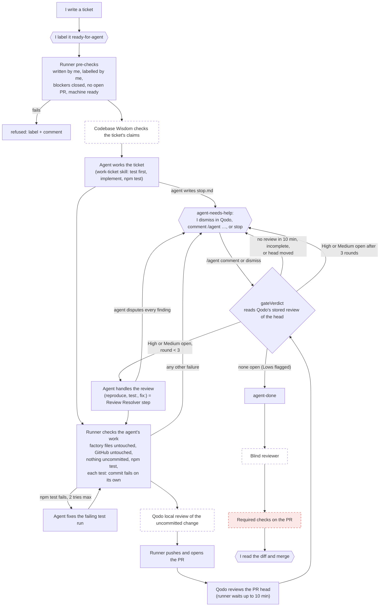

# My factory before Day 10 (22 Nov, main at 14c3520)

Drawn from `scripts/agent-watch.mjs` and `.claude/skills/work-ticket/SKILL.md` as they are on main, before any Day 10 change.

- Solid box: runs today, in the factory.
- Dashed box: in the brief, but not in the factory (done by hand, or not at all).
- Hexagon: I decide.

## Gaps the drawing shows

| Step in the brief | Today | Where |
|---|---|---|
| Wisdom checks the ticket before work | Not in the factory. Done by hand on Day 6 only. | `agent-watch.mjs` goes from pre-checks straight to the agent |
| Qodo local review of uncommitted code | Not in the factory. Unattended runs turn Qodo off because `qodo review` uploads local files (Qodo on #86). Done by hand on Day 8 only. | `agent-watch.mjs:169` |
| Required checks before merge | None. The only workflow is `pages.yml`. The `protect main` ruleset requires a PR, no status checks. | `.github/workflows/`, ruleset 27124387 |
| Completed Qodo review of the head before merge | `gateVerdict` decides DONE, but nothing stops me merging a NOT DONE PR. | `agent-watch.mjs` ends at a label |
| Blind review | Done by hand on Days 7–9. It found something Qodo didn't each time. | not in the runner |

Predictions for this run, written before any change (SHA-256 of the file published with the post): `3132909369f9b00d9d9183fd7cf2c308725a69c9b482092c7b5bc14400b34aa4`
