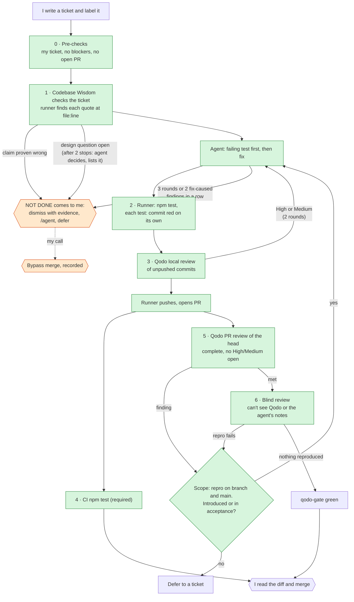

# My factory after Day 10

Drawn from `scripts/agent-watch.mjs`, `scripts/qodo-gate.mjs` and the `protect main` ruleset on main at f78fee9. Compare [before](01-diagram-before.md). Green: steps [#21](https://github.com/jtbinith/qodo-hack-2026/issues/21) went through ([07-run-21.md](07-run-21.md)). Orange: where I stepped in.

